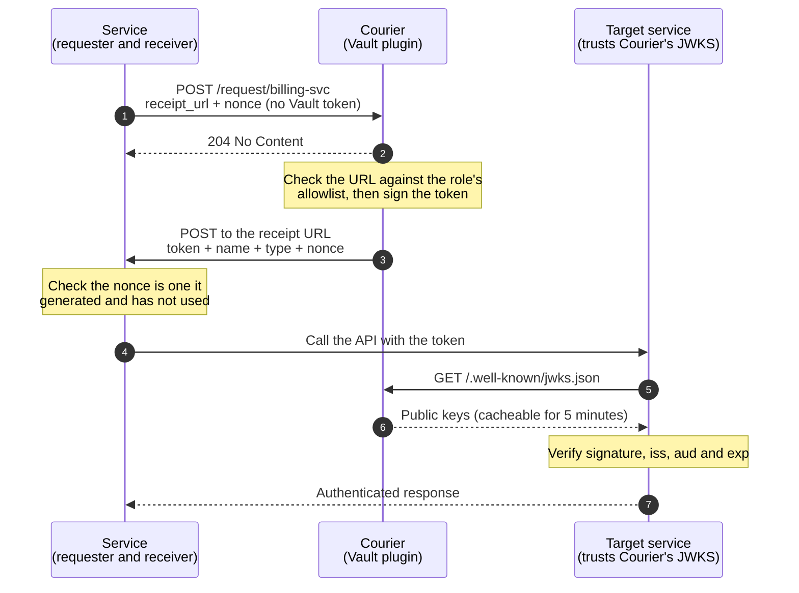

# vault-plugin-secrets-courier

Courier is a [Vault](https://www.vaultproject.io/) secrets engine that **delivers a
secret to a receiver without the requester ever seeing it**. It is a push model,
inspired by [Keepie](https://github.com/nicferrier/keepie): a service asks for
delivery and names a receipt URL; Courier checks the URL against an allowlist,
and only if it is on the list creates the secret and POSTs it there. The
requester is not authenticated and never receives the secret. The allowlisted
destination is the identity check.

What gets delivered is a **credential of some type**. Today the only type is
`jwt`: Courier signs a JSON Web Token for an arbitrary service identity (not
tied to a Vault entity) and delivers it, and publishes the matching OIDC
discovery document and JWKS. Issuing JWTs is one option the engine supports, not
what the engine is about. The delivery mechanics (allowlist, nonce, retry, rate
limits, network policy) are the same for every type. Each mount serves one type,
chosen by the mount option `type` (default `jwt`); another type, for example TLS
certificates, would be another mount of the same plugin with a different `type`,
so adding a type never changes the paths of an existing mount.

Vault does the heavy lifting: audit log, namespaces, replication, and key
storage behind the seal.

## How it works

1. An administrator enables a mount for a credential type, configures it, and
   creates a **role**. A role names the audience and the **receipt URLs** allowed
   to receive the credential.
2. A service calls `courier/request/<role>` **without a Vault token**, with a
   `receipt_url` and optionally a `nonce`.
3. Courier answers `204 No Content` at once. In the background it checks the URL,
   creates the secret and POSTs it to the receipt URL, with a nonce if one was
   supplied. The caller never sees it.
4. The receiver checks that the nonce is one it generated and has not used. The
   token is now its credential, and the receiver does not have to be the one that
   verifies it: it can present the token to another service to authenticate to
   it. That service is configured to trust Courier's issuer, and fetches the
   public keys from the plugin's JWKS endpoint (`<issuer>/.well-known/jwks.json`)
   to verify the signature, the issuer, the audience and the expiry.



The requester and the receiver are usually the same service, which runs the
endpoint behind its receipt URL; they do not have to be. The target service
checks that `aud` is its own audience, so give the role the audience that service
expects.

Because the request endpoint is unauthenticated, everything that goes wrong is
silent: an unknown role, a URL that is not on the allowlist, a rate-limited
request and a request over the in-flight limit all get the same empty `204`. The
role's `allowed_receipt_urls` is the only security boundary, so write access to
roles must be tightly granted.

## Setup

Build the plugin and register it with Vault (the plugin directory must be set in
the Vault server configuration):

```shell
make build                                   # bin/vault-plugin-secrets-courier
SHA256=$(sha256sum bin/vault-plugin-secrets-courier | cut -d' ' -f1)

vault plugin register -sha256="$SHA256" -command=vault-plugin-secrets-courier \
    secret vault-plugin-secrets-courier

vault secrets enable -path=courier -options=type=jwt vault-plugin-secrets-courier
```

The mount option `type` selects the credential type (`jwt` is the default and the
only type today) and cannot be changed later: a mount whose option no longer
matches the type recorded with its configuration refuses to serve. The paths in
this document assume the mount path `courier/`.

Optional hardening: let the `503` of the public endpoints carry its `Retry-After`
hint. Vault and OpenBao drop plugin response headers that the mount does not
list, so by default the `503` arrives without it; verifiers must not depend on it.

```shell
vault secrets tune -allowed-response-headers=Retry-After courier/
```

Configure the mount. The first write must include the `issuer`; it records the
mount's type and creates the signing keys:

```shell
vault write courier/config issuer=https://vault.example.com/v1/courier
```

Create a role that allows one receiver:

```shell
vault write courier/roles/billing-svc \
    allowed_receipt_urls=https://billing.internal/courier/receive \
    aud=payments-api \
    require_nonce=true nonce_in_token=true
```

## Usage

A service that wants a token delivered generates a random nonce, remembers it,
and asks Courier. No Vault token is needed:

```shell
curl --request POST \
     --data '{"receipt_url": "https://billing.internal/courier/receive", "nonce": "k3Jx9wQ2mZpL7vTa"}' \
     https://vault.example.com/v1/courier/request/billing-svc
```

Courier then POSTs a `multipart/form-data` request to the receipt URL:

| Field | Value |
|---|---|
| `token` | the credential; for type `jwt`, the signed token |
| `name` | the role name |
| `type` | the mount's credential type (`jwt`) |
| `nonce` | only if the request supplied one |

The receiver accepts the delivery only if `nonce` matches a pending value it
generated and has not used, then deletes it. Any `2xx` response counts as
delivered. New fields may be added later, so receivers must ignore fields they do
not know.

For a `jwt`, the payload looks like this (`nonce` appears only when the request
supplied one and the role sets `nonce_in_token`):

```json
{
  "iss": "https://vault.example.com/v1/courier",
  "sub": "https://billing.internal/courier/receive",
  "aud": "payments-api",
  "iat": 1793453400,
  "exp": 1793454000,
  "jti": "<unique token id>",
  "nonce": "k3Jx9wQ2mZpL7vTa"
}
```

`sub` is the receipt URL the token was delivered to. `jti` is a unique ID per
token, useful for replay detection and for recognizing a retried delivery (the
retry resends the same token, so the same `jti`); it is not a revocation handle.

Whoever verifies the token, the receiver itself or another service it presents
the token to, fetches the key in `/courier/.well-known/jwks.json` whose `kid`
matches the token header, verifies the signature, and checks `iss`, `aud` and
`exp`. Checking the nonce is only the receiver's job: it is the proof that the
delivery answers a request the receiver made.

## API

All endpoints require a Vault token unless marked **unauthenticated**.
Durations accept seconds or a duration string such as `10m`, and are stored in
whole seconds (a sub-second part is truncated).

### Configure the mount

Configures the mount. One endpoint holds the delivery settings below and the
parameters of the mount's credential type (for `jwt`, the section after them),
and both can be sent in one write. The first write must include `issuer`; it
records the mount's type and creates the initial signing keys, and roles cannot
be created before it. The delivery settings all have defaults. A write is a
partial update: parameters you do not send keep their stored values.

| Method | Path |
|---|---|
| `POST` | `/courier/config` |

#### Delivery parameters

- `delivery_retry` `(string: "never")` - `never` or `once`. With `once`, one more
  attempt is made after `retry_delay`, resending the same secret.
- `retry_delay` `(duration: "2s")` - wait before the single retry. 1s to 60s.
- `delivery_timeout` `(duration: "5s")` - time allowed for each delivery attempt.
  1s to 60s.
- `max_inflight` `(int: 100)` - maximum concurrent deliveries. Over the limit,
  requests are silently dropped. 1 to 10000.
- `allowed_networks` `(list of CIDRs: [])` - if set, deliveries may connect only
  to addresses inside these networks. Recommended in production. At most 64
  entries, no host bits set.
- `denied_networks` `(list of CIDRs: [])` - if set, deliveries may connect to any
  address outside these networks. Mutually exclusive with `allowed_networks`.

With both network lists empty, nothing restricts delivery beyond the receipt URL
allowlist and verified TLS. The policy is checked on the address actually
dialed, on every attempt.

#### JWT parameters

- `issuer` `(string: <required>)` - the `iss` claim and the base URL verifiers use
  to fetch the discovery document and the JWKS. Usually
  `<Vault address>/v1/<mount path>`. An `https` URL without userinfo, query,
  fragment or trailing slash, at most 2048 bytes. Changing it after keys exist
  invalidates every outstanding token.
- `alg` `(string: "ES256")` - `ES256` (P-256) or `RS256` (RSA, 2048-bit). Cannot
  be changed once the first key set exists.
- `rotation_period` `(duration: "24h")` - how often the next signing key becomes
  current. At least 6 minutes.
- `max_ttl` `(duration: "30m")` - upper bound on any role's `ttl`.
- `verification_ttl` `(duration: "1h")` - how long a retired key's public part
  stays in the JWKS. At least `max_ttl` plus 5 minutes plus 60 seconds, and at
  most 10 x `rotation_period`.

#### Sample payload

```json
{
  "issuer": "https://vault.example.com/v1/courier",
  "alg": "ES256",
  "rotation_period": "24h",
  "max_ttl": "30m",
  "verification_ttl": "1h",
  "delivery_retry": "once",
  "retry_delay": "2s",
  "delivery_timeout": "5s",
  "allowed_networks": ["10.0.0.0/8"]
}
```

#### Sample request

```shell
curl \
    --header "X-Vault-Token: ..." \
    --request POST \
    --data @payload.json \
    http://127.0.0.1:8200/v1/courier/config
```

### Read the mount configuration

Returns the effective values, defaults included, and the mount's `type`. Before the
first write only the delivery defaults are returned.

| Method | Path |
|---|---|
| `GET` | `/courier/config` |

#### Sample response

```json
{
  "data": {
    "type": "jwt",
    "issuer": "https://vault.example.com/v1/courier",
    "alg": "ES256",
    "rotation_period": 86400,
    "max_ttl": 1800,
    "verification_ttl": 3600,
    "delivery_retry": "once",
    "retry_delay": 2,
    "delivery_timeout": 5,
    "max_inflight": 100,
    "allowed_networks": ["10.0.0.0/8"],
    "denied_networks": []
  }
}
```

### Rotate the signing key

Always generates a fresh key pair and makes it the current signing key at once;
the stored next key is never promoted. The old current key is retired (public
part only). For incident response: with `revoke_previous` it is the only kill
switch for tokens already delivered.

| Method | Path |
|---|---|
| `POST` | `/courier/keys/rotate` |

#### Parameters

- `revoke_previous` `(bool: false)` - drop every retired key from the JWKS at
  once, including the one just replaced. Tokens signed with them stop verifying
  once a verifier refreshes its cached JWKS, which takes at least the 5-minute
  cache lifetime. This is a tool for a compromised signing key, not for revoking
  ordinary tokens: there is no per-token revocation and no introspection.

#### Sample request

```shell
vault write -f courier/keys/rotate
```

Scheduled rotation runs automatically every `rotation_period`; the next key is
published in the JWKS before it signs anything.

### Read keys

Returns key IDs and rotation times. Never returns private keys.

| Method | Path |
|---|---|
| `GET` | `/courier/keys` |

#### Sample response

```json
{
  "data": {
    "current_kid": "019a3f6e-2c1d-7b52-9d34-6b1c0f4e8a10",
    "next_kid": "019a3f6e-2c1e-7a0c-8e7f-3d5a91c2b7e4",
    "retired": [
      {"kid": "019a3f5b-91aa-7c4e-b2d8-0e6f4a1d3c55", "retire_at": "2026-11-01T13:00:00Z"}
    ],
    "next_rotation": "2026-11-02T12:00:00Z"
  }
}
```

### Create or update a role

A role names the receipt URLs allowed to receive credentials for it and holds the
fields of the mount's type (for `jwt`, the audience, the lifetime and the nonce
claim); it has no `type` of its own. A write is a partial update; `allowed_receipt_urls`
and `aud` are required on the first write only. Treat write access to roles as a
privileged operation: whoever can write a role decides where tokens are sent.

| Method | Path |
|---|---|
| `POST` | `/courier/roles/:name` |

The name matches `[a-z0-9]([a-z0-9_-]*[a-z0-9])?`, at most 64 characters: lowercase,
no dots, never normalized.

#### Parameters

- `allowed_receipt_urls` `(list: <required>)` - exact-match allowlist, 1 to 64
  entries, no duplicates. Each must follow the strict format below. Compared byte
  for byte, with no normalization. Redirects are never followed.
- `aud` `(string: <required>)` - the `aud` claim. Not empty, at most 256 bytes.
- `ttl` `(duration: min(10m, max_ttl))` - token lifetime. At least 2 minutes, at
  most `max_ttl`, and longer than the delivery window (`delivery_timeout`, or
  `retry_delay` + 2 x `delivery_timeout` with `delivery_retry=once`). If not sent
  on creation, the resolved default is stored.
- `require_nonce` `(bool: false)` - refuse requests for this role that omit a
  nonce.
- `nonce_in_token` `(bool: false)` - also put the supplied nonce in the token as
  the `nonce` claim.
- `min_request_interval` `(duration: "5s")` - minimum time between accepted
  requests for the same role and receipt URL; extra requests are silently
  dropped. 0 to 1 hour.
- `receipt_ca_pem` `(string: "")` - PEM CA bundle trusted when delivering to this
  role's URLs. If unset, the system roots are used. Certificates only, at most
  64 KiB. Verified TLS is always required.

**Receipt URL format.** `https://<host>[:<port>]<path>`, at most 2048 bytes:
lowercase `https`; a lowercase ASCII DNS name (internationalized names as
`xn--` punycode, no IP literals, no trailing dot); a port from 1 to 65535 without
leading zeros, and never `:443`; a path starting with `/` using only
`A-Z a-z 0-9 - . _ ~ /`, with no `.` or `..` segments and no percent-encoding.
No userinfo, query or fragment. A role write that breaks a rule is rejected with
the rule named; nothing is rewritten.

#### Sample payload

```json
{
  "allowed_receipt_urls": ["https://billing.internal/courier/receive"],
  "aud": "payments-api",
  "ttl": "10m",
  "require_nonce": true,
  "nonce_in_token": true
}
```

#### Sample request

```shell
curl \
    --header "X-Vault-Token: ..." \
    --request POST \
    --data @payload.json \
    http://127.0.0.1:8200/v1/courier/roles/billing-svc
```

### Read, list and delete roles

Reading or listing roles reveals the allowlist; deleting a role stops deliveries
for it.

| Method | Path |
|---|---|
| `GET` | `/courier/roles/:name` |
| `LIST` | `/courier/roles` |
| `DELETE` | `/courier/roles/:name` |

#### Sample response (read)

```json
{
  "data": {
    "allowed_receipt_urls": ["https://billing.internal/courier/receive"],
    "aud": "payments-api",
    "ttl": 600,
    "require_nonce": true,
    "nonce_in_token": true,
    "min_request_interval": 5,
    "receipt_ca_pem": ""
  }
}
```

#### Sample response (list)

```json
{
  "data": {
    "keys": ["billing-svc"]
  }
}
```

### Request delivery

**Unauthenticated.** Asks Courier to create a secret for the role and POST it to
a receipt URL. The caller never receives the secret; the response is empty.

| Method | Path |
|---|---|
| `POST` | `/courier/request/:role` |

#### Parameters

- `role` `(string: <required>)` - in the path.
- `receipt_url` `(string: <required>)` - must be byte-identical to an entry in the
  role's `allowed_receipt_urls`.
- `nonce` `(string: <optional>)` - 16 to 128 characters from `A-Za-z0-9_-`. If and
  only if supplied, it is included in the delivery.

#### Sample payload

```json
{
  "receipt_url": "https://billing.internal/courier/receive",
  "nonce": "k3Jx9wQ2mZpL7vTa"
}
```

#### Sample request

```shell
curl \
    --request POST \
    --data @payload.json \
    http://127.0.0.1:8200/v1/courier/request/billing-svc
```

#### Responses

The plugin returns exactly two statuses:

| Status | When |
|---|---|
| `204 No Content`, empty body | the request was accepted, and every silent drop: unknown role, URL not on the allowlist, inside `min_request_interval`, a duplicate already in flight, `max_inflight` reached, and internal faults (which are logged on the server) |
| `400 Bad Request` | a format error: `receipt_url` missing, `nonce` empty or invalid, `nonce` missing on a `require_nonce` role (which reveals that the role exists), or a wrong-typed field |

Other statuses come from Vault itself, for example `405` for a method other than
`POST` or `PUT`, and `429` if an operator has set a rate-limit quota on
`courier/request/*`.

**Delivery behavior.** The POST is made in the background. A `2xx` response
counts as delivered. With `delivery_retry=once`, a connection error, a timeout
or a `5xx` is retried once with the same secret and nonce; any other result is
final. There is no durable queue: a delivery in flight is lost if the node
restarts. No failure reaches the requester, so receivers need their own
timeout and may ask again. Deliveries connect directly (no proxy), never follow
redirects, require verified TLS, and are checked against `allowed_networks` or
`denied_networks`.

### Read OIDC discovery

**Unauthenticated.** The minimal discovery document a JWT verifier needs. Served
as a raw body, not in Vault's JSON envelope.

| Status | When |
|---|---|
| `200` | the document |
| `404` | `courier/config` has not been written |
| `503` | storage failed or the stored data is corrupt: a fixed body `{"error":"temporarily_unavailable"}`, `Content-Type: application/json` and `Cache-Control: no-store`. A `Retry-After: 30` hint is also sent but is not part of the contract: it reaches callers only if the mount allows it (see Setup) |
| `405`, `429` | from Vault itself: another method, or an operator's rate-limit quota |

| Method | Path |
|---|---|
| `GET` | `/courier/.well-known/openid-configuration` |

#### Sample response

```json
{
  "issuer": "https://vault.example.com/v1/courier",
  "jwks_uri": "https://vault.example.com/v1/courier/.well-known/jwks.json",
  "id_token_signing_alg_values_supported": ["ES256"]
}
```

### Read JWKS

**Unauthenticated.** The public keys: the next, the current and the unexpired
retired keys, with `Cache-Control: max-age=300`. Served as a raw body. The
statuses are the same as for discovery.

| Method | Path |
|---|---|
| `GET` | `/courier/.well-known/jwks.json` |

#### Sample response

```json
{
  "keys": [
    {"kty": "EC", "crv": "P-256", "use": "sig", "alg": "ES256", "kid": "<uuidv7-of-current>", "x": "<x>", "y": "<y>"},
    {"kty": "EC", "crv": "P-256", "use": "sig", "alg": "ES256", "kid": "<uuidv7-of-next>", "x": "<x>", "y": "<y>"}
  ]
}
```

## Policies

Only `request/*` and `.well-known/*` are unauthenticated. Everything else
needs a token. Minimal policies:

```hcl
# Mount configuration, including the credential type's parameters
path "courier/config" { capabilities = ["create", "read", "update"] }

# Role administrators
path "courier/roles/*" {
  capabilities = ["create", "read", "update", "delete", "list"]
}

# Operators who may rotate the signing key
path "courier/keys/rotate" {
  capabilities = ["update"]
}
```

Vault's `allowed_parameters` can delegate part of a role, for example letting a
team lead change `ttl` but not `aud` or `allowed_receipt_urls`. The first write
to a config or role endpoint needs `create`; later writes need `update`.

## Security notes

- The role's allowlist is the whole boundary of the unauthenticated endpoint.
  Grant role writes narrowly and review them in the audit log. The request
  itself is audited, with the nonce and receipt URL hashed.
- Use a nonce. Without it, anyone who can reach Vault can trigger a delivery to
  an allowlisted URL; the receiver should reject any delivery whose nonce it did
  not generate.
- Set `allowed_networks` to the receivers' ranges in production. Courier does not
  support an egress proxy.
- A delivered token cannot be revoked individually. Keep `max_ttl` short, and use
  `keys/rotate` with `revoke_previous` only for a compromised key.
- No response carries internal detail, authenticated or not. A handler that fails
  logs the cause on the server (at most one line a minute per handler, never the
  token, a private key, a nonce or a request body) and answers with a fixed
  message: the empty `204` on the request endpoint, the `503` above on the public
  endpoints, and `internal error` on authenticated paths. The one exception is
  Vault's own wrong-typed-field `400`, which echoes only the caller's input.
- The request endpoint answers the same empty `204` for most failures, but its
  response time differs slightly between a drop and an accepted request; this is
  an accepted limitation.

## Development

```shell
make build        # bin/vault-plugin-secrets-courier (stripped, -trimpath)
make test         # unit tests
make live-test    # runs the plugin inside a real Vault; needs VAULT_BIN
```

### Versioning and releases

The project follows [Semantic Versioning](https://semver.org/) and keeps a
[changelog](CHANGELOG.md). The version is the git tag (for example `vX.Y.Z`); `make build`
embeds it in the binary through `git describe`, and the plugin reports it to
Vault. Check it with `make version`, or override it with
`make build VERSION=<version>`. Register the plugin with the same version:

```shell
VERSION=$(make version)
vault plugin register -sha256="$SHA256" -command=vault-plugin-secrets-courier \
    -version="$VERSION" secret vault-plugin-secrets-courier
```

Every user-visible change goes under `[Unreleased]` in the changelog in the same
pull request. To release, move those entries under a new version heading, merge,
and tag the merge commit on `main`.

`make live-test` starts `vault server -dev` with the plugin registered and drives
it over HTTP (`internal/livetest`, build tag `live`). Run it with
`VAULT_BIN=/path/to/vault make live-test`, using a Vault 1.18.x binary. It has
passed with the same results on these versions:

- Vault v1.18.5
- Vault v1.19.5
- Vault v1.20.4
- OpenBao v2.0.0
- OpenBao v2.2.0
- OpenBao v2.4.0
- OpenBao v2.7.2

`VAULT_BIN` may point at a `bao` binary. Recent OpenBao cannot enable audit
devices through the API, so the test declares the audit device in a server config
file for it.

It checks:

- mounting, including the mount option `type` reaching the plugin (an unsupported
  type refused when the mount is enabled, a changed option refusing to serve
  after a reload);
- create versus update capability, and `403` for every authenticated path
  without a token;
- raw JWKS and discovery responses, and an unauthenticated request with a verified
  token delivered to a TLS receiver;
- the request statuses, rotation, the audit entry, and a rate-limit quota on
  `courier/request/*`;
- keys surviving seal and unseal;
- damaged storage (the key set corrupted through `sys/raw`) giving the fixed
  `503` and `internal error` with no internal detail.

| Path | Contents |
|---|---|
| `cmd/vault-plugin-secrets-courier` | plugin `main` |
| `internal/backend/backend.go` | factory, configuration lock, lifecycle, `PathsSpecial` |
| `internal/backend/path_*.go` | one file per endpoint group |
| `internal/backend/credential.go`, `type_jwt.go` | the credential type interface and the `jwt` type |
| `internal/backend/keys.go`, `token.go` | key generation and rotation, token signing |
| `internal/backend/cache.go` | read cache for the hot path, cleared by writes and the `Invalidate` hook |
| `internal/backend/storage.go`, `validate*.go` | storage helpers, validators and cross-validation |
| `internal/backend/netpolicy.go`, `ratelimit.go`, `delivery.go` | network policy, rate-limit state, delivery |
| `internal/livetest` | the live test |

The plugin builds against the Vault 1.18 SDK (`sdk` v0.14.0, `api` v1.15.0) and
needs Go 1.26 or later. It uses `go-jose` v4 for keys and signing and
`google/uuid` (`NewV7`) for `kid` and `jti`.

Replication is covered only from the plugin's side: unit tests give the backend
the replication state and mount locality Vault would report (performance
standby, performance secondary with a replicated or a local mount, DR secondary,
failover) and check that requests and writes return `ErrReadOnly` where Vault
would forward them, that only a write-safe node delivers and rotates, and that a
standby's cache follows the `Invalidate` hook. Vault's own forwarding is
Enterprise code and has not been run: that needs two licensed Enterprise
clusters. Also not done: the scheduled rotation tick on a live server, and CI.
